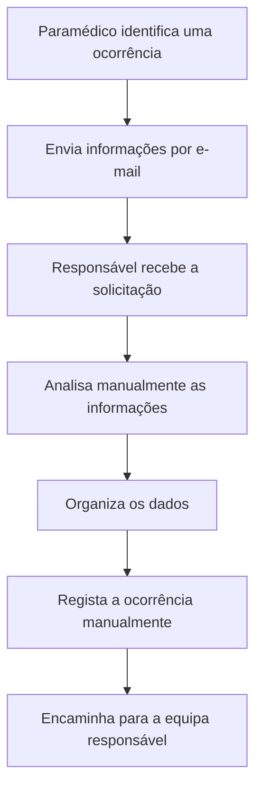
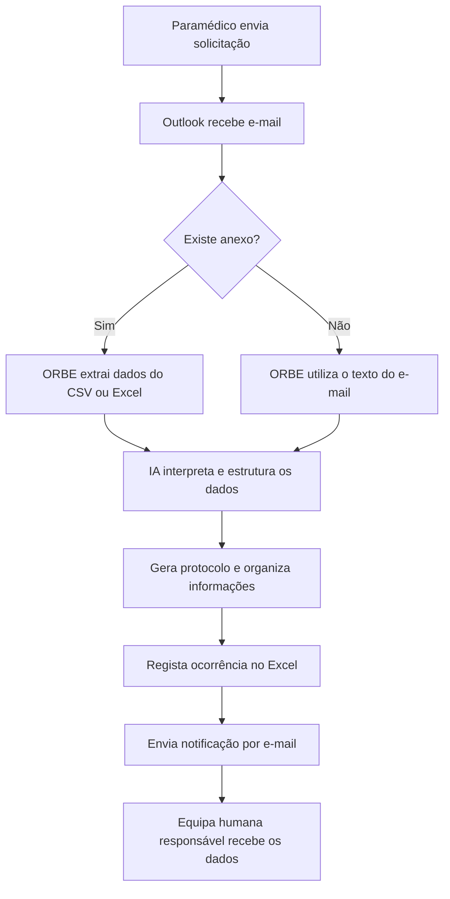

# Diagrama do Processo — ORBE

## 1. Processo anterior à automação

## 2. Processo com o ORBE

## 3. Resultado da automação

- Automatização do recebimento das solicitações.
- Interpretação dos dados com Inteligência Artificial.
- Padronização dos registos operacionais.
- Geração automática de protocolos.
- Centralização das informações no Excel.
- Notificação automática da equipa responsável.

**Nota:** O ORBE apoia a organização e o encaminhamento operacional, sem substituir a avaliação dos profissionais.
